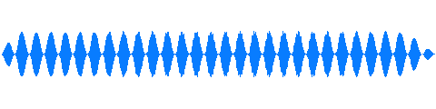
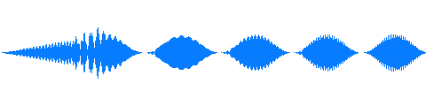

### 5. Sound Element Concepts (Individual)

Sound supports the shift from playful shopping to visual overload. Small rewards invite interaction, while repetition and distortion suggest how consumption can begin to control personal identity. This connects to SDG 12 and the quote, “The things you own end up owning you.”

The current version uses seven WAV recordings. Each sound name links to its recording, with a waveform showing the full duration.

| Sound element                                                                                                         | Waveform                                                                        | Description                                                                                 | Conceptual impact                                                                                                     |
| --------------------------------------------------------------------------------------------------------------------- | ------------------------------------------------------------------------------- | ------------------------------------------------------------------------------------------- | --------------------------------------------------------------------------------------------------------------------- |
| **Message Pop** ([WAV](sounds/COMM2754-26t3-A1-s3977954_TranThanhTam_Message_Pop.wav))                                |                  | A 0.040-second cue when landing-page messages appear or disappear.                          | Reflects how advertising repeatedly attracts our attention.                                                           |
| **Entering the Store** ([Game Start WAV](sounds/COMM2754-26t3-A1-s3977954_TranThanhTam_Game_Start.wav))               |                    | Plays when the shopping challenge begins. Duration: 1.007 seconds.                          | Makes shopping feel inviting and playful before its consequences appear.                                              |
| **Collection Reward** ([Challenge Click WAV](sounds/COMM2754-26t3-A1-s3977954_TranThanhTam_Challenge_Click.wav))      |          | A 0.600-second cue whenever an object is collected.                                         | Encourages repeated interaction through small rewards, suggesting the temporary satisfaction of buying something new. |
| **Melting Identity** ([Datamosh WAV](sounds/COMM2754-26t3-A1-s3977954_TranThanhTam_Datamosh.wav))                     |                        | A quiet 4.281-second loop. Timed cues influence the melting image.                          | Suggests that accumulated possessions are making personal identity unstable.                                          |
| **Endless Offers** ([Notification Appear WAV](sounds/COMM2754-26t3-A1-s3977954_TranThanhTam_Notification_Appear.wav)) |  | Accompanies the sale-label sequence and restarts after an upgrade. Duration: 1.290 seconds. | Represents the continuing pressure to buy and improve, even as the figure breaks apart.                               |
| **Accepting the Upgrade** ([End Click WAV](sounds/COMM2754-26t3-A1-s3977954_TranThanhTam_End_Click.wav))              |                      | Plays when a sale label is activated. Duration: 1.519 seconds.                              | Confirms a choice that creates more offers and fragmentation, questioning whether each upgrade improves the self.     |
| **Back for More** ([Transition WAV](sounds/COMM2754-26t3-A1-s3977954_TranThanhTam_Transition.wav))                    |                    | A 1.788-second sound during the return to the landing page. It stops on navigation.         | Suggests that the cycle of consumption can begin again.                                                               |

All filenames use the submission prefix `COMM2754-26t3-A1-s3977954_TranThanhTam_`. The earlier prize sound is no longer included because the current experience does not use the offer wheel.

For A2 and A3, these ideas can be developed into three original sound directions: a **Reward Loop** that varies with collected items, a **Melting Self** made from stretched and fragmented recordings, and an **Endless Upgrade** motif that changes as sale labels multiply.

For recording sources and media permissions, see [ASSET_CREDITS.md](ASSET_CREDITS.md).
